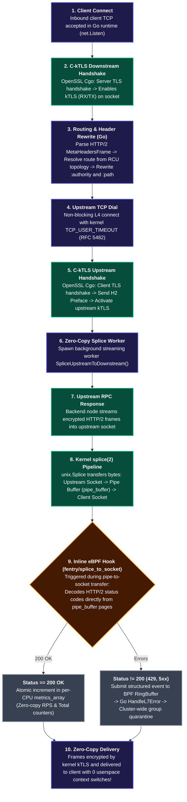

# Data Plane Architecture and Routing

## 1. Asymmetric Data Plane
In traditional proxies, both inbound and outbound traffic pass through application userspace buffers, incurring the overhead of `read`/`write` system calls and userspace TLS encryption/decryption.

`balancer-proxy` implements a hybrid approach:
1. **Inbound Path (Client -> Proxy):** The socket is terminated directly inside the Linux kernel via `kTLS` (`TCP_ULP`). Go reads the headers of the initial HTTP/2 frame (`MetaHeadersFrame`), resolves the target path (`:path`), selects an upstream endpoint using the "Snake" (Host Interleaving) algorithm, and rewrites pseudo-headers (`:authority`, `:path`).
2. **Outbound Path (Proxy -> Backend -> Client):** After establishing an upstream connection, Go spawns a background streaming worker that forwards data in 1 MB blocks using `unix.Splice`:
   `Upstream Socket -> Kernel Pipe (pipe_buffer) -> Downstream Socket`
   The response payload never enters userspace.

## 2. In-Kernel Telemetry (eBPF)
To collect metrics without compromising `splice` throughput:
- An eBPF program is attached via an `fentry` probe to the kernel function `splice_to_socket`.
- During pipe page transfers, the eBPF program executes an inline HTTP/2 finite-state-machine (FSM) parser, decoding HPACK headers (static table entries and literals).
- Successful responses (200 OK) atomically increment counters within `metrics_array` (a `BPF_MAP_TYPE_ARRAY` map initialized with `BPF_F_MMAPABLE`).
- Errors (429, 5xx) are submitted to userspace via a `BPF_MAP_TYPE_RINGBUF` to trigger circuit breaker quarantine procedures.

## 3. Static Arenas and RCU Snapshots
To eliminate heap allocations and reduce GC pressure on hot execution paths:
- IP address arrays (`AllIps`) and logical entities (`LogicalEntities`) are statically pre-allocated at startup.
- Topology updates (such as DNS re-resolutions) never mutate existing structures. Instead, a new `RoutingState` object containing only the active chain index generations (`ChainGeneration`) is constructed and published atomically via an `atomic.Pointer[RoutingState]`.

